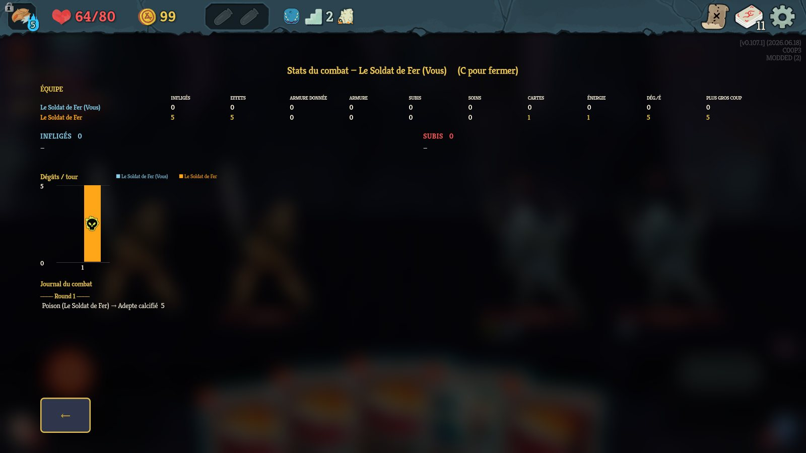
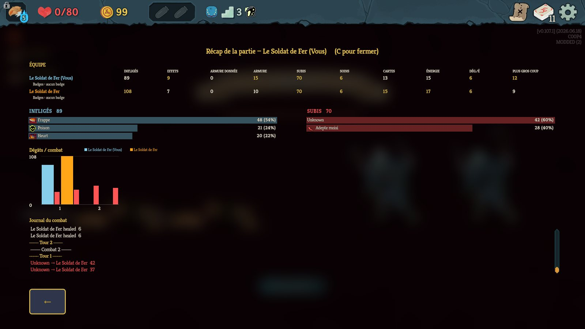
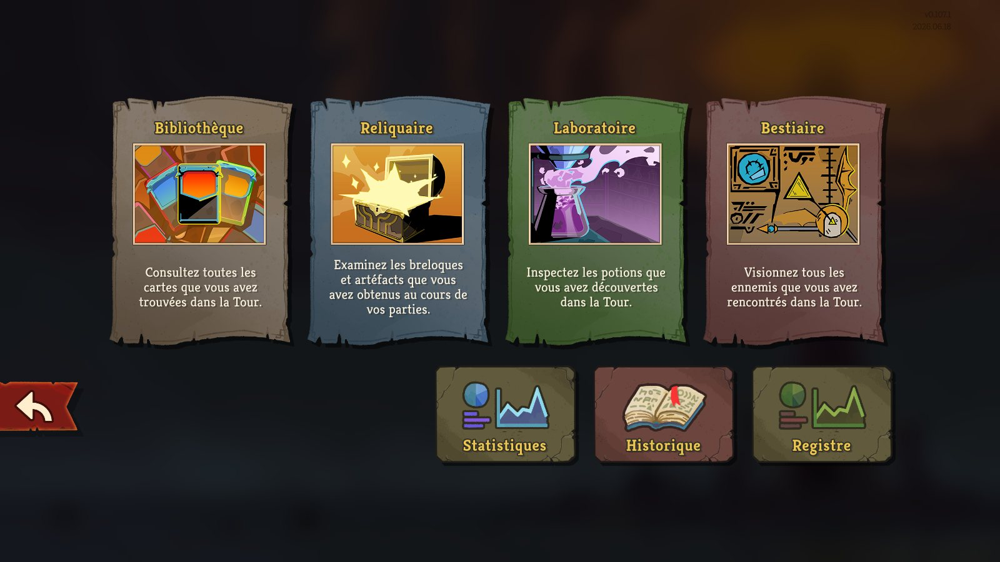
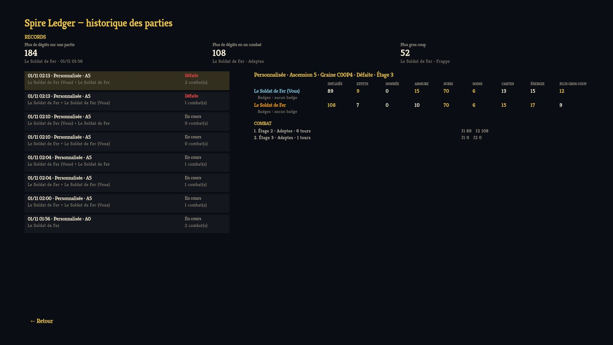

# Spire Ledger — Slay the Spire 2 mod

> Fork of [brian-gates/sts2-damage-charts](https://github.com/brian-gates/sts2-damage-charts) (MIT) focused on
> co-op. The sections after "Upstream Damage Charts" describe the features inherited from it.

**What Spire Ledger adds**

- **Fair co-op attribution.** Damage with no direct dealer (Poison, Doom, …) is credited to the players
  who applied that power, split by the stacks each applied, instead of to whoever's PC is counting. Both
  PCs record identical numbers ([evidence](docs/testing/)).
- **More per-player stats**, per fight and per run: effects applied, block given to allies, cards played,
  energy spent, damage per energy, biggest hit (plus the existing dealt / taken / block / heal / potions).
- **Party table** in the combat stats (hotkey `C`) and in the run recap: one row per player, the best
  value of each column in gold.
- **End-of-run recap** opens on the game-over screen with the badges each player got.
- **Run history** — one JSON file per run in `%APPDATA%\SlayTheSpire2\SpireLedger\runs` (seed, mode,
  Ascension, modifiers, players, every fight, result, badges, the game's own counters), kept across
  save & continue.
- **Ledger screen** — a "Registre" / "Ledger" button in the Compendium next to Statistics: records,
  your runs, and each run's party totals, badges and fights.
- The mod's own labels follow the game language (French / English).

| Co-op combat stats | End-of-run recap | Compendium | Ledger |
|---|---|---|---|
|  |  |  |  |

**Install:** subscribe on the [Steam Workshop](https://steamcommunity.com/sharedfiles/filedetails/?id=3831558895)
(friends-only for now), or download the zip from Releases (or build it, below), copy `SpireLedger.dll` and
`SpireLedger.json` into the game's `mods` folder, start the game and accept loading mods. Both co-op
players can join each other even if only one has it (it doesn't affect gameplay); whoever has it sees the
whole party's stats.

**Developing:** `scripts/dev/sts2.py` drives the game for tests through a locally patched
[STS2MCP](https://github.com/Gennadiyev/STS2MCP) (seeded custom runs, Steam-less local instances, a 2-player
FastMP co-op on one PC via `scripts/dev/coop-start.sh`, an auto-fight loop, screenshots).
`scripts/release.ps1 -Version x.y.z [-Publish]` builds, tests and packages a release.

### Keep your unlocks when playing modded

With any mod enabled the game uses a separate, empty save profile, so the Daily Climb, characters and
multiplayer Ascension are locked. **Spire Ledger offers to fix this itself**: on the main menu, when your
normal profile has more unlocks than the modded one, a dialog offers to copy it (also available from the
Ledger screen). It goes through the game's own save store, so the Steam Cloud copy is updated too, and
the previous modded progress is backed up in `%APPDATA%\SlayTheSpire2\SpireLedger\backups`.

For scripting, the same copy is available outside the game (close the game first; the normal profile is
only read, the modded one is backed up):

```powershell
powershell -ExecutionPolicy Bypass -File scripts\import-vanilla-progress.ps1
```

Then launch the game with mods right away. Options: `-Profile 2` for another save slot, `-SteamId <id>`
if several Steam accounts played on this PC. The run history is not copied: the game's Steam Cloud sync
deletes modded history runs that aren't in the cloud.


## Upstream Damage Charts

A standalone damage analytics and incoming-damage forecast mod for [Slay the Spire 2](https://store.steampowered.com/app/2868840/).

**[Subscribe on the Steam Workshop](https://steamcommunity.com/sharedfiles/filedetails/?id=3753047703)** to install it.

- **Incoming-damage forecast** (always on in combat, docked beside your character): the HP you are
  about to lose this turn and what you'll be left at, as a range when something is uncertain. Counts
  enemy intents, damage over time, Infection and self-damage cards, Block and Osty, and end-of-turn Block
  (Plating, Orichalcum, Cloak Clasp); ignores enemies that will die to Poison before they act. A thin
  HP bar previews the loss. Reads **Safe** when nothing can hurt you and pulses when the turn can kill
  you. Hover it for the per-round HP-lost history and an itemized list of sources.
- **Damage Out | In / Round**: a small always-on chart stacked above the forecast, damage dealt vs taken
  for the last 8 rounds; hover a round for its breakdown. `show_bars: false` hides it, `bars_style:
  "full"` swaps in the larger chart.
- **Combat stats** (hotkey, default **C**): a full-screen breakdown of damage **dealt** and **taken**
  **by source**, a per-round chart, the run so far, potions used, and a scrollable combat log (mouse
  wheel, trackpad or scrollbar). Card and pet hits are always named, and so is much of the damage from
  powers (Poison, Thorns), relics and potions; the rest shows as `Status`/`Other`.
- **End-of-combat summary**: a compact version beside the rewards list after each fight, with potions
  used. C hides and shows it until you move on.
- **Run recap**: the same hotkey out of combat (e.g. on the victory/death screen) opens a run-wide recap
  of dealt / taken / healed / block, by source and per fight.
- **Game-native look**: uses the game's own fonts, icons, hover-tip frames, scrollbars and shaders
  (loaded from your install, never bundled). Optional **big-moment effects** reuse the game's own
  damage-number and flash VFX.
- Single-player and multiplayer (per-player colors). Reads game state directly — no dependency on any
  other mod.

## Screenshots

| | |
|---|---|
|  |  |
| Forecast with its HP preview, and the round chart above it | A turn that can kill you: the forecast goes red |
|  |  |
| End-of-combat summary: dealt and taken by source, potions, combat log | Turn 1 of a fight |

Taken with the settings of the time, before `source_hooks` was on by default: the summary's `Status`
row is the Fire Potion's damage, which is now named.

## Requirements

- A copy of **Slay the Spire 2** installed (the build references the game's own assemblies; nothing
  proprietary is bundled or redistributed here).
- The **.NET 9 SDK** to build the mod from source.

## How it works

- **Amounts** come from subscribing to each `Creature.CurrentHpChanged` event (true post-block HP
  loss). Player-creature drops = taken; enemy drops = dealt; heals and block are totaled separately.
- **Source attribution** comes from a Harmony prefix on the central `CreatureCmd.Damage(...)`: card
  hits use `cardSource.Title`, pet hits credit the pet. A curated list of the game's damage-dealing
  power/relic/orb/potion hooks (found by a static call-graph sweep of `sts2.dll`) stamps the source for
  the hit that follows (`source_hooks`, on by default); damage it can't place is labeled `Status`/`Other`.
- **Potions used** come from a postfix on `CombatHistory.PotionUsed`.
- **The forecast** reads intents, powers, relics and the hand through reflection each frame, read-only.
- **Startup freeze workaround**: with any mod loaded, the game's Sentry shutdown can hang startup; the
  mod skips that native call (see [KNOWN_ISSUES.md](docs/KNOWN_ISSUES.md)).

## Build & install

The project resolves the game's DLLs (`sts2.dll`, `GodotSharp.dll`, `0Harmony.dll`) at build time
from your STS2 install. Point `STS2GameDir` at that install. The build is the same on every
platform; only the install path and the `mods/` location differ.

### macOS

```bash
GAME_DIR="$HOME/Library/Application Support/Steam/steamapps/common/Slay the Spire 2"
dotnet build SpireLedger.csproj -c Release -o out -p:STS2GameDir="$GAME_DIR"
MODS_DIR="$GAME_DIR/SlayTheSpire2.app/Contents/MacOS/mods"
cp out/SpireLedger.dll "$MODS_DIR/"
cp mod_manifest.json "$MODS_DIR/SpireLedger.json"
```

### Windows

```powershell
# Adjust to your Steam library; the .csproj defaults to D:\SteamLibrary\... if unset.
$GameDir = "C:\Program Files (x86)\Steam\steamapps\common\Slay the Spire 2"
dotnet build SpireLedger.csproj -c Release -o out -p:STS2GameDir="$GameDir"
copy out\SpireLedger.dll "$GameDir\mods\"
copy mod_manifest.json "$GameDir\mods\SpireLedger.json"
```

### Linux

```bash
GAME_DIR="$HOME/.steam/steam/steamapps/common/Slay the Spire 2"
dotnet build SpireLedger.csproj -c Release -o out -p:STS2GameDir="$GAME_DIR"
cp out/SpireLedger.dll "$GAME_DIR/mods/"
cp mod_manifest.json "$GAME_DIR/mods/SpireLedger.json"
```

Then launch the game and enable **Damage Charts** in **Settings → Mods** (accept the consent dialog
on first launch). Restart the game after replacing the DLL — mods load at startup.

## Steam Workshop

### Players

Spire Ledger is on the Workshop as a **friends-only** item for now:
[steamcommunity.com/sharedfiles/filedetails/?id=3831558895](https://steamcommunity.com/sharedfiles/filedetails/?id=3831558895).
Subscribe, enable it in **Settings → Mods** and restart the game. On first launch it offers to import your
normal progress (Daily Climb, characters) into the modded profile.

### Maintainers (publishing, Windows)

Publishing uses MegaCrit's official [`sts2-mod-uploader`](https://github.com/megacrit/sts2-mod-uploader),
which talks to Steam directly, so it runs **locally with the Steam client open and logged in**, never in
CI. The workspace is `dist/workshop/` (`workshop.json` with the bilingual description and `visibility`,
`image.png` under 1 MB); built content is staged into `dist/workshop/content/` (git-ignored).

```powershell
# One-time: unzip ModUploader-win-x64.zip from the uploader's releases into tools\ModUploader\ (git-ignored).
# Build, stage content\ and upload (-StageOnly to stop before uploading):
powershell -ExecutionPolicy Bypass -File scripts\package-workshop.ps1
```

The first upload **creates** the item and writes `dist/workshop/mod_id.txt`: **commit it** so later runs
update the same item. Before each update, bump `version` in `mod_manifest.json` and `changeNote` in
`workshop.json`. To go public, set `"visibility": "public"` and re-run (or change it on the Workshop
page). `scripts/package-workshop.sh` is the macOS equivalent inherited from Damage Charts.

## Config — `SpireLedger.conf` (next to the DLL in `mods/`)

```json
{
  "enabled": true,
  "hotkey": "c",
  "forecast": true,
  "native_visuals": true
}
```

- `hotkey`: a bare key like `c` (the default) or `f9`, or modifier+key, e.g. `cmd+d`, `shift+d`, `alt+d`, `ctrl+d`.
- `forecast`: set `false` to hide the incoming-damage forecast.
- `forecast_anchor`: `"player"` (default) docks the forecast beside your character; dragging it switches
  to `"free"` and remembers the spot.
- `summary_on_combat_end`: set `false` to skip the end-of-combat summary.
- `run_recap`: set `false` to disable the out-of-combat run recap (the hotkey then only toggles the
  in-combat breakdown).
- `show_bars`: **default `true`.** Set `false` to hide the always-on Damage Out | In / Round chart.
- `bars_style`: `"compact"` (default), the small chart above the forecast, or `"full"` for the larger one.
- `bars_anchor`: `"forecast"` (default) stacks the chart above the forecast; dragging it switches to
  `"free"` and remembers the spot.
- `ui_scale`: a number (default `1.0`) that scales every panel (text and spacing) on top of the automatic
  resolution scaling. Bump it (e.g. `1.25`) if text reads too small.
- `native_visuals`: **default `true`.** Set `false` for the original flat look.
- `vfx_moments`: **default `false`.** Set `true` for the game's own VFX on a new biggest hit, a fully
  blocked enemy turn, and a new top damage source.
- `source_hooks`: **default `true`.** Attributes damage-over-time and relic/orb/potion hits by name
  (Poison, Doom, Thorns, …) instead of the generic `Status`/`Other`, via a curated set of patched hooks.
  Some effects that deal their damage after an animation still show as `Status`. Set `false` to turn
  the hooks off.

Changes to `hotkey`, `show_bars` and `vfx_moments` are picked up live (within about half a second);
the rest apply the next time the game starts.

## License

MIT — see [LICENSE](LICENSE).
