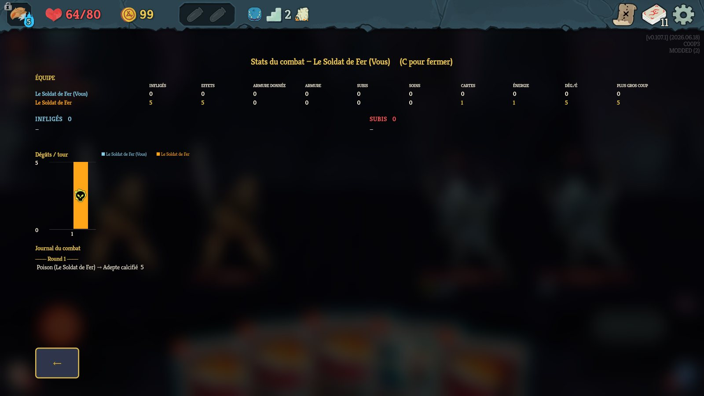
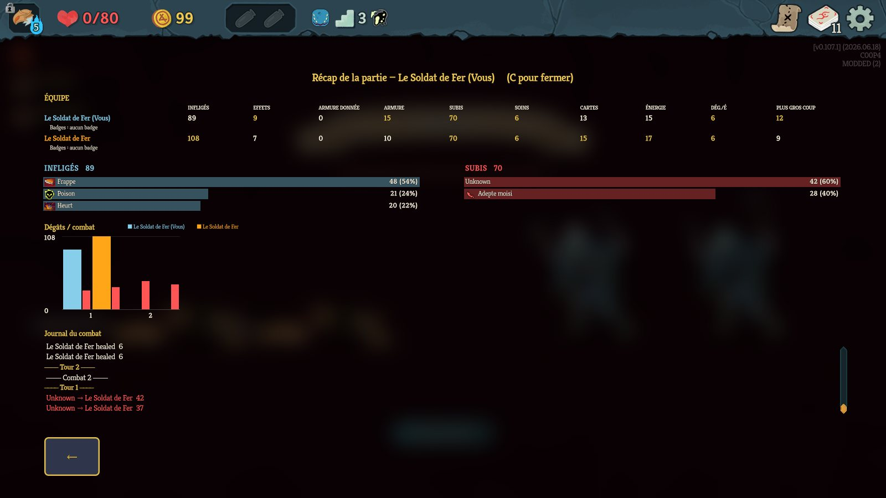
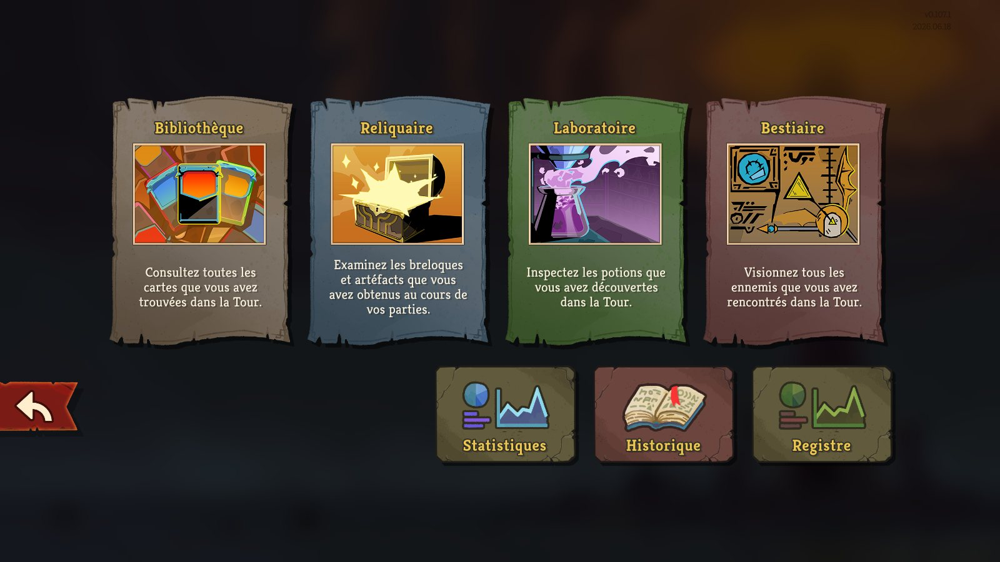
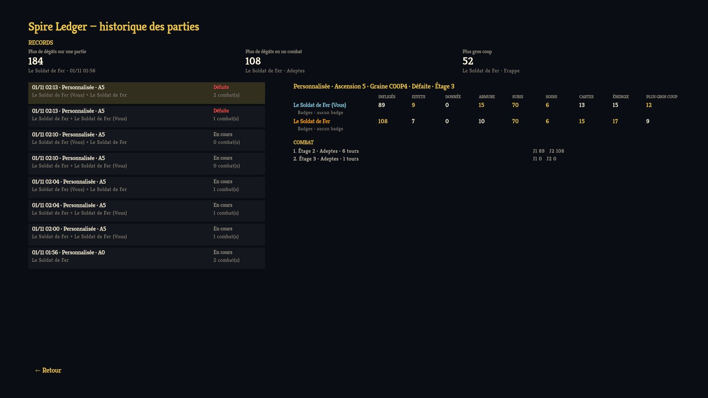

# Spire Ledger — rapport de nuit (1er novembre 2026)

## En bref

Les phases 1 à 6 sont faites, testées en jeu et committées sur la branche `chore/rename-spire-ledger`
de `K:\Projets\spire-ledger`. **Rien n'est poussé sur GitHub** ni publié : tu avais dit « pas encore ».
La version finale du mod est installée dans le dossier `mods` du jeu, seule (l'outil de test est
retiré), et ton profil de sauvegarde 1 est de nouveau le profil actif.

| Phase | État | Vérifié comment |
|---|---|---|
| 1. Attribution juste en multi (poison, doom) | ✅ | Partie co-op locale à 2 instances, mêmes chiffres sur les 2 PC |
| 2. Nouvelles stats par joueur | ✅ (sauf « assist ») | Combats auto-joués, JSON relus |
| 3. Historique JSON par partie | ✅ | Fichiers écrits après chaque combat et en fin de partie |
| 4. Récap de fin de partie + badges | ✅ | Capture sur l'écran de game over |
| 5. Écran « Registre » dans le Compendium | ✅ | Bouton cliqué en jeu, capture |
| Interface en français | ✅ | Captures |
| 6. Script de release | ✅ (non publié) | Zip `v0.1.0` produit en local |

## Ce que tu vas voir en jeu

| Stats du combat en co-op (touche C) | Récap de fin de partie |
|---|---|
|  |  |

| Compendium : nouveau bouton « Registre » | Écran Registre |
|---|---|
|  |  |

Avant, le Compendium n'avait que Statistiques ([capture d'origine](../screenshots/before_compendium.webp)),
et les panneaux du mod étaient en anglais.

## Détail par phase

**Phase 1 — attribution juste.** Le jeu note chaque effet posé, et par qui
(`CombatHistory.PowerReceived`). Le mod compte les cumuls posés par chaque joueur sur chaque ennemi.
Ensuite, il partage les dégâts du poison ou du doom au prorata de ces cumuls. Avant, ces dégâts
allaient au joueur du PC qui comptait.
Test : en co-op, le joueur 1 pose 5 poisons et le joueur 2 en pose 10 sur le même ennemi. Résultat :
**10 dégâts de poison pour J1, 19 pour J2**, identiques sur les deux instances. Les fichiers sont dans
[`docs/testing/`](../testing/). Le calcul du partage a 5 tests unitaires (19/19 tests passent).

**Phase 2 — stats en plus**, par combat et par partie : effets posés, armure donnée aux alliés, cartes
jouées, énergie dépensée, dégâts par énergie, plus gros coup. Elles s'ajoutent à infligés, subis,
armure, soins et potions.

**Phase 3 — historique.** Un fichier JSON par partie dans `%APPDATA%\SlayTheSpire2\SpireLedger\runs`.
Il est rangé hors du dossier `steam\` exprès : la synchro du cloud Steam supprime les fichiers qu'elle
ne connaît pas. Il contient :
- l'identifiant (seed), le mode, l'Ascension, les affixes et les joueurs ;
- chaque combat avec toutes les stats de chaque joueur ;
- en fin de partie : victoire ou défaite, l'étage, les badges de **chaque** joueur, et les compteurs
  du jeu lui-même (`DamageDealt`, `DebuffsApplied`) pour comparer avec les nôtres.

Après une sauvegarde puis « Continuer », les combats déjà enregistrés sont rechargés dans le récap.

**Phase 4 — récap de fin de partie.** Il s'ouvre tout seul sur l'écran de game over. On y voit un
tableau « Équipe » (une ligne par joueur, la meilleure valeur de chaque colonne en or) et les badges
de chacun, sous leur nom affiché en jeu. Le récap est aussi accessible avec C hors combat.

**Phase 5 — Registre.** Le bouton est une copie du bouton Statistiques du jeu : même cadre, même
police, même animation. L'écran affiche :
- les records : plus de dégâts sur une partie, en un combat, et le plus gros coup ;
- la liste paginée des parties ;
- pour la partie choisie : le tableau d'équipe, les badges et la liste des combats.

Pour fermer : bouton Retour ou Échap.

**Phase 6 — release.** Pour préparer le zip seulement :

```bash
powershell -ExecutionPolicy Bypass -File scripts\release.ps1 -Version 0.1.0
```

Le script compile, lance les tests et crée `dist\release\SpireLedger-v0.1.0.zip` (DLL, manifeste,
`INSTALL.txt`). Avec `-Publish`, il ajoute un tag `v0.1.0`, le pousse et crée la release GitHub.
Il n'y a pas de CI, car la compilation a besoin des DLL du jeu.

## Comment j'ai testé (banc de test)

- **STS2MCP**, le mod qui pilote le jeu par une API locale, est relu et compilé depuis les sources.
  Mes modifications sont dans `K:\Projets\sts2-tools\STS2MCP`, branche `local-hardening`, non poussée :
  - durcissement : plus d'accès depuis un navigateur (CORS et en-tête Origin refusés), suppression
    de profil désactivée ;
  - ajouts : console de dev, captures d'écran, démarrage en mode personnalisé avec identifiant fixe,
    touche clavier, clic sur un nœud ;
  - le port se règle par variable d'environnement.

  Il n'est installé dans `mods` que pendant les tests.
- **Parties reproductibles** : mode personnalisé avec identifiant (seed) imposé. Le mode standard
  refuse les seeds.
- **Co-op sur un seul PC** : `--force-steam off` lance le jeu sans Steam, avec des sauvegardes à part
  dans `%APPDATA%\SlayTheSpire2\default`, qui ne touchent jamais tes profils. Ensuite
  `--fastmp host_custom` / `--fastmp join` connecte deux instances en local. Le script
  `scripts/dev/coop-start.sh` fait tout ça en une commande.
- `scripts/dev/sts2.py fight` joue un combat automatiquement, avec des choix toujours identiques.

## Ce qui n'est pas fait ou pas vérifié

- **Pas testé en vrai co-op Steam avec ton ami.** Seulement en co-op local sur un PC (FastMP). C'est
  le prochain test à faire ensemble.
- **Badges** : le hook tourne pour les 2 joueurs et l'enregistrement marche. Mais je n'ai vu que des
  fins de partie sans badge (morts provoquées au 2ᵉ combat). Les noms affichés pour de vrais badges
  ne sont pas encore vérifiés.
- **Dégâts « assist »** (le bonus de Vulnérable crédité à celui qui l'a posé) : pas fait.
- **Doom** : même mécanisme que le poison, mais non testé en jeu.
- Le partage du poison suit les cumuls **posés**, pas les cumuls **restants**. C'est une
  approximation raisonnable, pas exacte au point près.
- Registre : la liste des combats montre les plus récents qui tiennent à l'écran, sans défilement.
- Le README reprend encore, en anglais, la doc de Damage Charts pour les fonctions héritées.

## Ce qui a changé sur ta machine

- Installés : SDK .NET 9, GitHub CLI (`gh`), connecté au compte MokoGuy, et l'outil `ilspycmd`
  (décompilation du jeu, dans `K:\Projets\sts2-tools\decomp`).
- **Profil moddé 3** = copie de ton profil 1, réservé aux tests. Tes profils 1 normal et moddé sont
  intacts, et le profil 1 est à nouveau l'actif.
- Mes parties de test sont rangées dans `%APPDATA%\SlayTheSpire2\SpireLedger\runs-tests-2026-11-01` :
  ton Registre démarre vide.
- `scripts/import-vanilla-progress.ps1` est corrigé. Le jeu garde un fichier local seulement si sa
  date égale **exactement** celle du cloud. Le script recopie donc la date du cloud (lue dans
  `remotecache.vdf` de Steam). L'option `-TargetProfile` permet aussi de cloner vers un autre profil.

## Décisions qui t'attendent

1. **Pousser la branche** sur `MokoGuy/spire-ledger`, puis publier la v0.1.0 (`release.ps1 -Publish`).
2. **Forker STS2MCP** sur ton compte pour y garder nos ajouts de test.
3. **Tester avec ton ami en vrai co-op Steam**, puis itérer sur l'interface : tailles de police,
   couleurs, place du tableau d'équipe.
